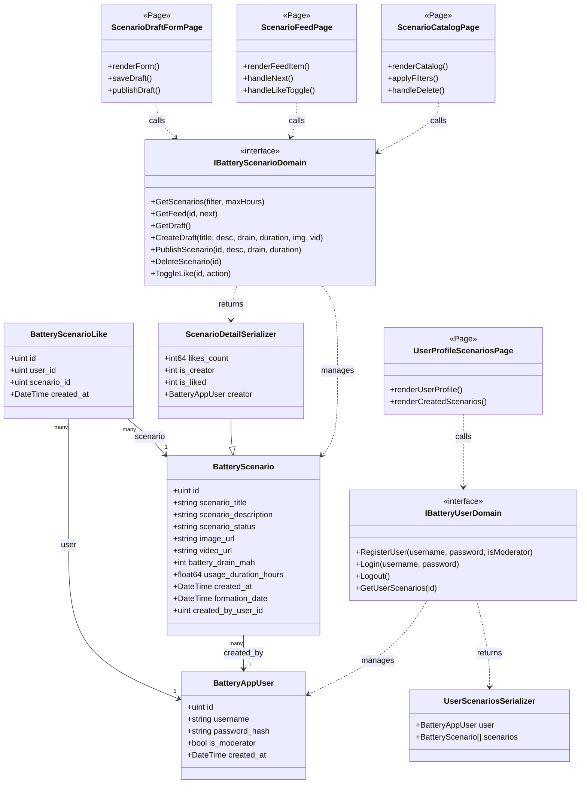

# Расчет времени автономной работы телефона — Веб-сервис REST API (ЛР №3)

Данный репозиторий представляет собой бэкенд системы расчета времени автономной работы мобильных устройств по сценариям использования аккумулятора (серфинг, игры, видео, навигация, чтение и др.).

Разработка выполнена в рамках **Лабораторной работы №3** на языке **Go** с использованием веб-фреймворка **Gin**, ORM **GORM**, базы данных **PostgreSQL** и объектного хранилища **MinIO**.

---

## 1. Предметная область и соглашения по неймингу

- **Предметная область**: Расчет времени автономной работы телефона.
- **Услуги**: Сценарии использования устройства (`battery_scenarios`: серфинг, игры, видео, навигация, чтение и др.).
- **Поля предметной области (2 обязательных поля)**:
  1. `battery_drain_mah` — расход емкости аккумулятора за сессию (мА·ч).
  2. `usage_duration_hours` — длительность сессии сценария (часы).
- **Связанные сущности**:
  - `battery_app_users` — пользователи системы (создатели сценариев, модераторы).
  - `battery_scenario_likes` — отметки «лайк» (связь M:M между пользователями и сценариями).
- **REST-стандарты**: Все успешные ответы возвращают запрашиваемые сущности или массивы напрямую с корректными HTTP-кодами (`200 OK`, `201 Created`), **без избыточных оберток вида `status: success`**.

---

## 2. Структура базы данных (PostgreSQL)

База данных состоит из трех ключевых таблиц без каскадного удаления (`ON DELETE RESTRICT`).

### 2.1 Таблица `battery_scenarios` (Сценарии использования аккумулятора)

| Столбец | Тип | Ограничения | Описание |
|---|---|---|---|
| `id` | `SERIAL` | `PRIMARY KEY` | Уникальный идентификатор сценария |
| `scenario_title` | `VARCHAR(24)` | `NOT NULL`, `CHECK(1..24)` | Наименование сценария использования |
| `scenario_description`| `VARCHAR(1000)`| `DEFAULT ''`, `CHECK(<=1000)`| Подробное описание сценария |
| `scenario_status` | `VARCHAR(20)` | `NOT NULL`, `DEFAULT 'draft'`| Статус (`draft`, `published`, `deleted`)|
| `image_url` | `VARCHAR(500)`| `DEFAULT ''` | Ссылка на обложку/иллюстрацию в MinIO |
| `video_url` | `VARCHAR(500)`| `DEFAULT ''` | Ссылка на короткое видео в MinIO |
| `battery_drain_mah` | `INT` | `NOT NULL`, `CHECK(0..9999)` | Расход заряда аккумулятора (мА·ч) |
| `usage_duration_hours`| `NUMERIC(4,1)`| `NOT NULL`, `CHECK(>=0)` | Длительность сценария (часы) |
| `created_at` | `TIMESTAMPTZ` | `NOT NULL` | Дата и время создания записи |
| `formation_date` | `TIMESTAMPTZ` | `NULL` | Дата и время публикации/формирования |
| `created_by_user_id` | `INT` | `NOT NULL`, `FK -> battery_app_users(id)` | ID создателя сценария |

> **Уникальный частичный индекс**: `uq_user_single_draft` на `(created_by_user_id) WHERE scenario_status = 'draft'`. Гарантирует наличие не более одного активного черновика у одного пользователя.

### 2.2 Таблица `battery_app_users` (Пользователи)

| Столбец | Тип | Ограничения | Описание |
|---|---|---|---|
| `id` | `SERIAL` | `PRIMARY KEY` | Идентификатор пользователя |
| `username` | `VARCHAR(50)` | `UNIQUE`, `NOT NULL` | Логин пользователя |
| `password_hash` | `VARCHAR(100)`| `NOT NULL` | Хеш пароля (скрыт из JSON: `json:"-"`) |
| `is_moderator` | `BOOLEAN` | `NOT NULL`, `DEFAULT FALSE` | Флаг прав модератора |
| `created_at` | `TIMESTAMPTZ` | `NOT NULL` | Дата и время регистрации |

### 2.3 Таблица `battery_scenario_likes` (Лайки M:M)

| Столбец | Тип | Ограничения | Описание |
|---|---|---|---|
| `id` | `SERIAL` | `PRIMARY KEY` | Идентификатор отметки |
| `user_id` | `INT` | `NOT NULL`, `FK -> battery_app_users(id)` | Пользователь, поставивший лайк |
| `scenario_id` | `INT` | `NOT NULL`, `FK -> battery_scenarios(id)` | Оцениваемый сценарий |
| `created_at` | `TIMESTAMPTZ` | `NOT NULL` | Время выставления отметки |

> **Уникальный индекс**: `idx_user_scenario_like` на `(user_id, scenario_id)` исключает дублирование лайков от одного пользователя.

---

## 3. Функция-Singleton текущего пользователя

Согласно методическим указаниям, в ЛР №3 пользователь-создатель зафиксирован константой в пакете `singleton`:

```go
package singleton

import (
	"battery-life/internal/app/ds"
)

const CurrentUserID uint = 1

func GetCurrentUserID() uint {
	return CurrentUserID
}

func GetCurrentUser() *ds.BatteryAppUser {
	return &ds.BatteryAppUser{
		ID:          CurrentUserID,
		Username:    "tester_alex",
		IsModerator: false,
	}
}
```

Все методы REST API (`GetScenariosAPI`, `GetScenarioFeedAPI`, `GetDraftScenarioAPI`, `CreateDraftScenarioAPI`, `PublishScenarioAPI`, `DeleteScenarioAPI`, `ToggleLikeAPI`) получают текущего пользователя через `singleton.GetCurrentUserID()`, что обеспечивает изолированность и строгую валидацию авторства (soft delete и публикация доступны только автору).

---

## 4. Интеграция с MinIO и генерация имен файлов на латинице

При добавлении сценария (`POST /api/scenarios`) файлы изображения (`image`) и видео (`video`) передаются в виде `multipart/form-data`.
- Для каждого файла проверяется Mime-тип (`image/*`, `video/*`).
- Имя файла генерируется **строго на латинице**:
  `scenario_<id>_<mediaType>_<timestamp>.<ext>`
  *(например, `scenario_57_image_1791203253111200127.svg`, `scenario_57_video_1791203253115417301.mp4`)*.
- Файлы сохраняются в бакет `scenarios` в MinIO.
- Полный публичный URL вида `http://localhost:9002/scenarios/<latin_filename>` записывается в поля `image_url` и `video_url` таблицы `battery_scenarios`.

---

## 5. Спецификация REST API

Все методы API доступны по префиксу `/api`. В соответствии с указанием, успешные ответы возвращают JSON-объекты или массивы **без `status: success`**.

| Метод | URL | Описание | Код ответа |
|---|---|---|---|
| `GET` | `/api/scenarios` | Список опубликованных сценариев с фильтрацией | `200 OK` |
| `GET` | `/api/scenarios/feed?id=:id&next=true` | Лента: сценарий по ID или следующий (параметры в query) | `200 OK` |
| `GET` | `/api/scenarios/draft` | Получение черновика текущего пользователя | `200 OK` / `404 Not Found` |
| `POST` | `/api/scenarios` | Создание черновика с загрузкой фото и видео в MinIO | `201 Created` |
| `PUT` | `/api/scenarios/:id/publish` | Публикация черновика (смена статуса draft -> published) | `200 OK` |
| `DELETE`| `/api/scenarios/:id` | Логическое удаление сценария (soft delete) | `200 OK` |
| `POST` | `/api/scenarios/:id/like` | Поставить / отменить лайк (`{"like": 1/0}`) | `200 OK` |
| `POST` | `/api/users/register` | Регистрация нового пользователя | `201 Created` |
| `POST` | `/api/users/login` | Аутентификация пользователя (заглушка ЛР4) | `200 OK` |
| `POST` | `/api/users/logout` | Деавторизация пользователя (заглушка ЛР4) | `200 OK` |

### Примеры запросов и ответов

#### 1. GET `/api/scenarios?search=гейминг&max_hours=10`
**Ответ (`200 OK`):**
```json
[
  {
    "id": 1,
    "scenario_title": "Ретро гейминг",
    "scenario_description": "Приятно проведите время за игрой детства, не переживая за автономность телефона",
    "scenario_status": "published",
    "image_url": "http://localhost:9002/scenarios/gaming.png",
    "video_url": "http://localhost:9002/scenarios/gaming.mp4",
    "battery_drain_mah": 1000,
    "usage_duration_hours": 5.0,
    "created_at": "2026-09-21T16:58:14.539434+03:00",
    "formation_date": "2026-09-21T16:58:14.539434+03:00",
    "created_by_user_id": 1,
    "likes_count": 2,
    "is_creator": 1,
    "is_liked": 1
  }
]
```

#### 2. POST `/api/scenarios` (multipart/form-data)
**Поля формы:**
- `scenario_title`: "Навигация в пути"
- `scenario_description`: "Использование GPS-навигатора при поездках на авто"
- `battery_drain_mah`: 650
- `usage_duration_hours`: 4.5
- `image`: файл (изображение)
- `video`: файл (видео)

**Ответ (`201 Created`):**
```json
{
  "id": 57,
  "scenario_title": "Навигация в пути",
  "scenario_description": "Использование GPS-навигатора при поездках на авто",
  "scenario_status": "draft",
  "image_url": "http://localhost:9002/scenarios/scenario_57_image_1791203253111200127.svg",
  "video_url": "http://localhost:9002/scenarios/scenario_57_video_1791203253115417301.mp4",
  "battery_drain_mah": 650,
  "usage_duration_hours": 4.5,
  "created_at": "2026-10-05T15:27:33.104877+03:00",
  "formation_date": null,
  "created_by_user_id": 1,
  "likes_count": 0,
  "is_creator": 1,
  "is_liked": 0,
  "creator": {
    "id": 1,
    "username": "tester_alex",
    "is_moderator": false,
    "created_at": "2026-09-21T16:58:14.52817+03:00"
  }
}
```

#### 3. PUT `/api/scenarios/57/publish`
**Тело JSON:**
```json
{
  "scenario_title": "GPS Навигация",
  "scenario_description": "Точное ведение по маршруту в авто с постоянной активностью экрана и чипа GPS",
  "battery_drain_mah": 850,
  "usage_duration_hours": 5.0
}
```
**Ответ (`200 OK`):**
```json
{
  "id": 57,
  "scenario_title": "GPS Навигация",
  "scenario_description": "Точное ведение по маршруту в авто с постоянной активностью экрана и чипа GPS",
  "scenario_status": "published",
  "image_url": "http://localhost:9002/scenarios/scenario_57_image_1791203253111200127.svg",
  "video_url": "http://localhost:9002/scenarios/scenario_57_video_1791203253115417301.mp4",
  "battery_drain_mah": 850,
  "usage_duration_hours": 5.0,
  "created_at": "2026-10-05T15:27:33.104877+03:00",
  "formation_date": "2026-10-05T15:28:05.863977593+03:00",
  "created_by_user_id": 1,
  "likes_count": 0,
  "is_creator": 1,
  "is_liked": 0
}
```

#### 4. POST `/api/scenarios/57/like`
**Тело JSON:**
```json
{
  "like": 1
}
```
**Ответ (`200 OK`):**
```json
{
  "scenario_id": 57,
  "liked": 1,
  "likes_count": 1
}
```

#### 5. DELETE `/api/scenarios/57`
**Ответ (`200 OK`):**
```json
{
  "id": 57,
  "message": "сценарий успешно удален"
}
```

---

## 6. Порядок демонстрации и скриншоты для отчета

Файл коллекции запросов для Insomnia / Postman: [`postman_collection.json`](file:///home/mariam/GolandProjects/battery-life/postman_collection.json).

| № Скриншота | Что показать | Эндпоинт / Действие |
|---|---|---|
| **Скриншот 1** | Коллекция из 10 обязательных запросов в Postman/Insomnia | Дерево коллекции `Battery Life REST API` |
| **Скриншот 2** | GET списка сценариев с фильтром | `GET /api/scenarios?search=гейминг&max_hours=10` |
| **Скриншот 3** | POST добавление услуги с фото и видео | `POST /api/scenarios` (multipart/form-data) |
| **Скриншот 4** | GET получение полей черновика | `GET /api/scenarios/draft` |
| **Скриншот 5** | PUT публикация услуги (смена статуса) | `PUT /api/scenarios/:id/publish` |
| **Скриншот 6** | GET лента по ID со следующим сценарием | `GET /api/scenarios/feed?id=1&next=true` |
| **Скриншот 7** | POST отметка лайка | `POST /api/scenarios/:id/like` (`like: 1` и `0`) |
| **Скриншот 8** | DELETE удаление услуги (soft delete) | `DELETE /api/scenarios/:id` |
| **Скриншот 9** | POST регистрация нового пользователя | `POST /api/users/register` |
| **Скриншот 10**| POST аутентификация пользователя (заглушка) | `POST /api/users/login` |
| **Скриншоты 11-13** | Измененные данные через `SELECT` в БД | `SELECT * FROM battery_scenarios;`, `SELECT * FROM battery_scenario_likes;`, `SELECT * FROM battery_app_users;` |
| **Скриншоты 14-15** | Код моделей и сериализаторов | `internal/app/ds/battery_scenario.go`, `internal/app/ds/serializers.go` |
| **Скриншоты 16-17** | Функция-Singleton и README | `internal/app/singleton/user.go` и данный `README.md` |

---

## 7. UML-диаграмма классов системы (StarUML)

Файл проекта диаграммы StarUML: [`battery_life_diagram.mdj`](file:///home/mariam/GolandProjects/battery-life/battery_life_diagram.mdj).



---

## 8. Запуск проекта

```bash
# 1. Запуск контейнеров PostgreSQL и MinIO
docker compose up -d

# 2. Применение миграций схемы и тестовых данных
go run cmd/migrate/main.go

# 3. Запуск веб-сервера (порт 8080)
go run cmd/battery-life/main.go
```
